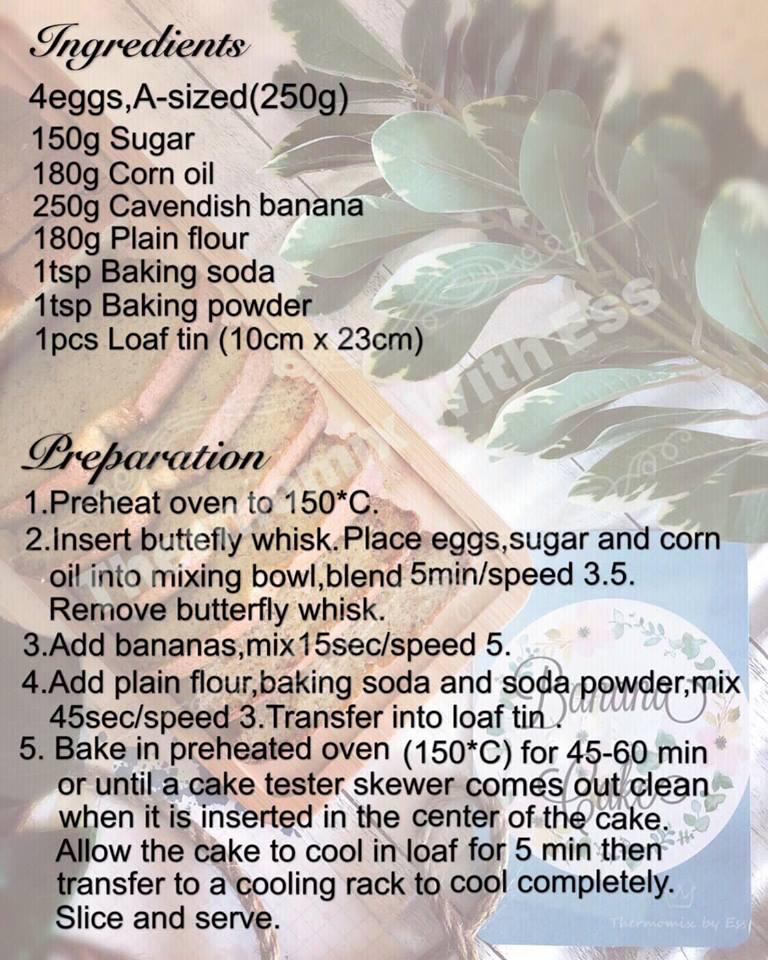

# Banana Cake

## Ingredients
125g banana
2 eggs (125g)  
50g sugar  
100g butter, melted  
90g plain flour  / cake flour
1/2 tsp baking soda
1/2 tsp baking powder

## Steps
1. Preheat oven to 150 deg celsius
2. Melt butter in microwave, approx 30 secs. Make sure to **microwave intermittently on low heat and cover the container** to avoid the cold butter from exploding in the microwave.
3. Whisk eggs, sugar and melted butter together evenly
4. Add mashed bananas to mixture, whisk evenly
5. Add plain flour, baking soda, and baking powder to mixture, whisk evenly
6. Transfer into loaf tin and bake in 150 deg celsius for 25-30 minutes. The cake is ready if you insert a skewer into the center of the cake and it comes out clean.

## Additional tips
- Use room temperature eggs to achieve a fluffier texture
- You could add toppings to the banana cake such as walnuts, or chocolate chips.

## References
[Banana Cake - The Best Banana Cake Recipe - Rasa Malaysia](https://rasamalaysia.com/banana-cake/)  
