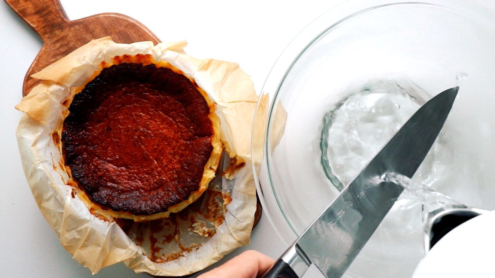

# Burnt Cheesecake

## Ingredients
226g cream cheese (philadephia is the best!)  
2 eggs  
30g sugar  
200ml whipping cream  
15g cake flour / corn starch  
1/2 tsp vanilla extract  
1/2 tsp apple cider vinegar  

## Steps
1. Preheat oven to 230 deg celsius
2. Blend all the ingredients together until smooth
3. Drop the pan onto the counter to remove air bubbles from the batter.
4. Transfer into 5-inch cake pan and bake in 230 deg celsius for 22-25 minutes.

## Additional tips
- Blend the eggs/flour/sugar first, followed by cheese, then cream and the rest.
- Do not cut the cake when its warm, or oil may ooze out
- Using whipping cream gives a lighter texture than heavy cream.

## References
[Basque Burnt Cheesecake](https://norecipes.com/burnt-basque-cheesecake/)
