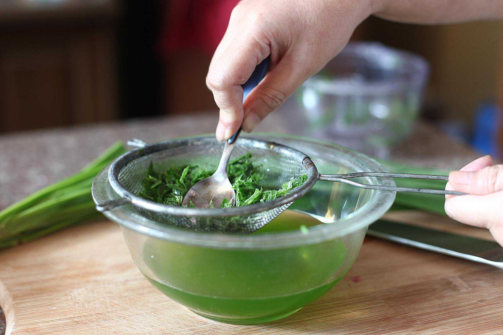
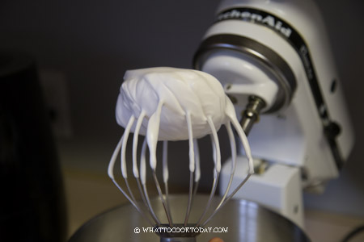
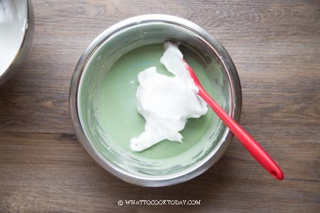
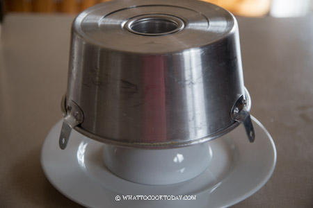

# Pandan Chiffon Cake

## Ingredients
40g cake flour  
1/8 tsp salt  
3/4 tsp baking powder  
2 eggs   
35g sugar (10g for cake batter, 25g for meringue)   
30ml pandan juice (made from 7 pandan leaves)  
13g oil  
25ml cocounut milk  
pinch of cream of tartar / lemon juice / vinegar

## Steps
1. Make pandan juice from the pandan leaves. Cut the leaves into small pieces, and blend it with 3 tbsp of water. strain the juice out and set it aside.  
  

2. Prepare the cake batter.  
    a. Prepare the flour mixture (40g cake flour, 1/8 tsp salt, 3/4 tsp baking powder), sift and set aside.  
    b. separate egg yolks and white into two bowls. yolks for the cake batter, whites for making meringue later.  
    c. whisk the egg yolks with 10g of sugar and 13g of cooking oil  
    d. add in 25ml coconut milk and 30ml pandan juice. whisk evenly.  
    e. gradually add in flour mixture from step a, whisk until there are no lumps.

3. Prepare the meringue  
    _*now is also a good time to preheat your oven to **165 deg c**)_  
    a. beat the egg whites until frothy.  
    b. add cream of tartar / lemon juice / vinegar and whip until it turns whitish.  
    c. gradually add sugar as you beat the egg whites until you get a stiff peak.  
      

4. Fold the meringue into the cake batter we prepared in step 2 until evenly mixed. Mix gently to avoid the air escaping from the meringue.  
    

5. Pour the batter into an **UNGREASED** chiffon cake pan, smooth the surface. Gently drop the cake pan onto your counter several times to pop large bubbles in the batter. 

6. bake in the oven for 30 minutes. You can check whether the cake is done around the 25min mark, and lower the temperature to 150 deg. Make sure not to open the oven door prematurely or you will deflate the cake.  

7. Take the cake out, drop the cake pan onto your counter several times to prevent shringkage. Invert the pan upside down for cooling.  
  

8. Remove the cake after 1-2 hours, only when it has completely cooled. 

## Additional tips
- Its easier to separate the egg yolks when they are cold
- Use room temperature eggs and coconut milk to achieve a fluffier texture

## References
[Original recipe](https://whattocooktoday.com/pandan-chiffon-cake.html)  
[Pandan juice recipe](https://whattocooktoday.com/how-to-make-pandan-juice-and-pandan-extract.html)  